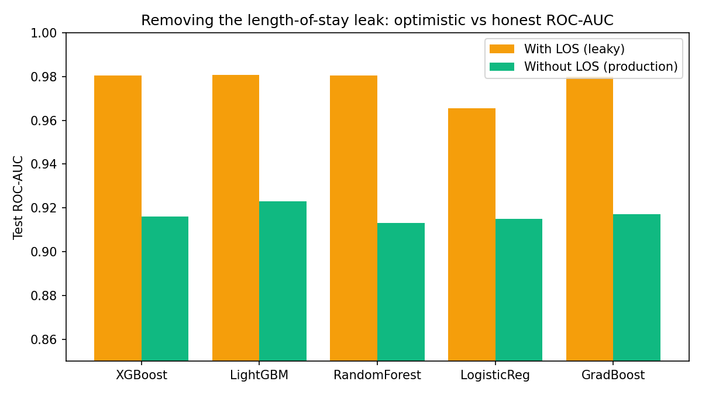
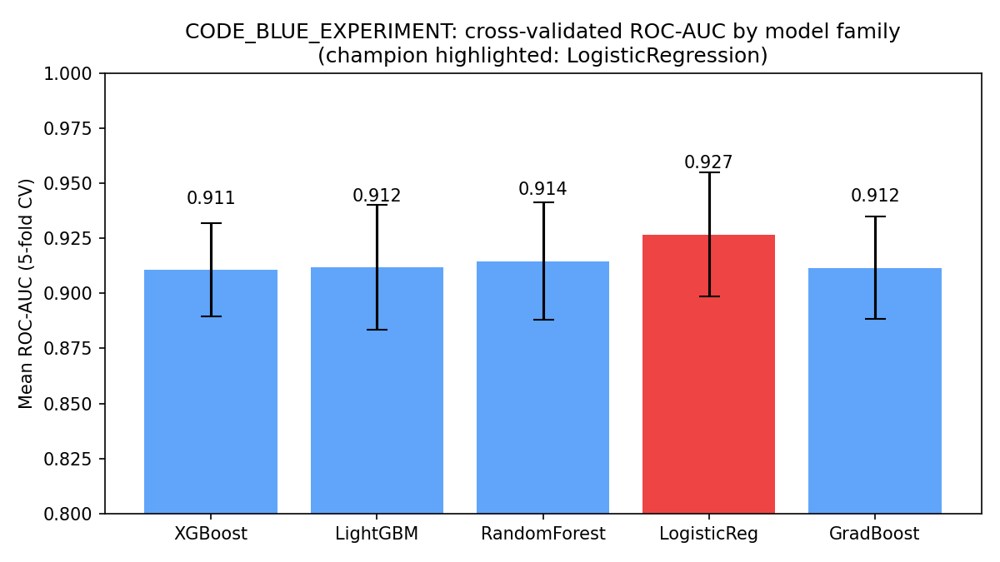
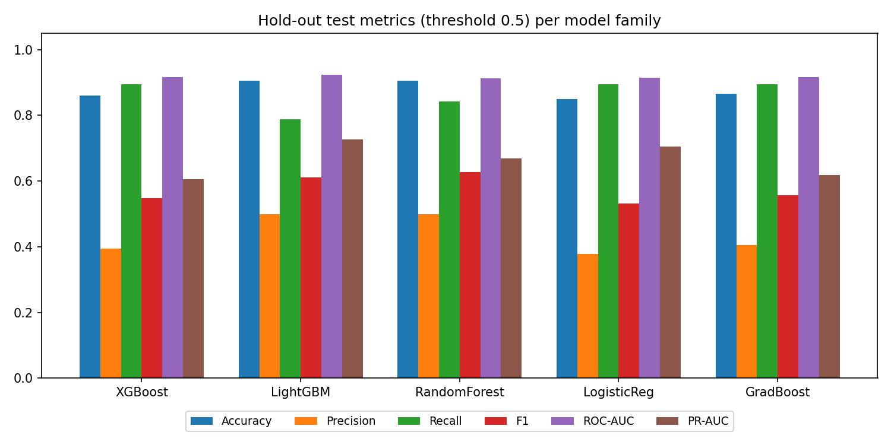
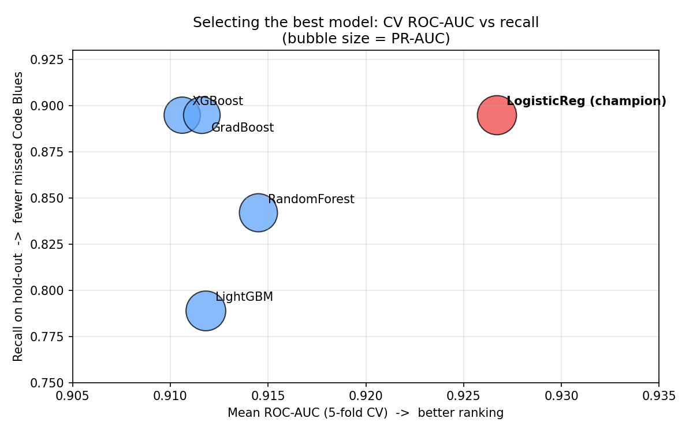
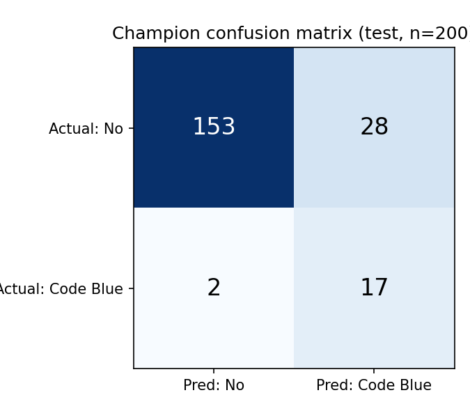
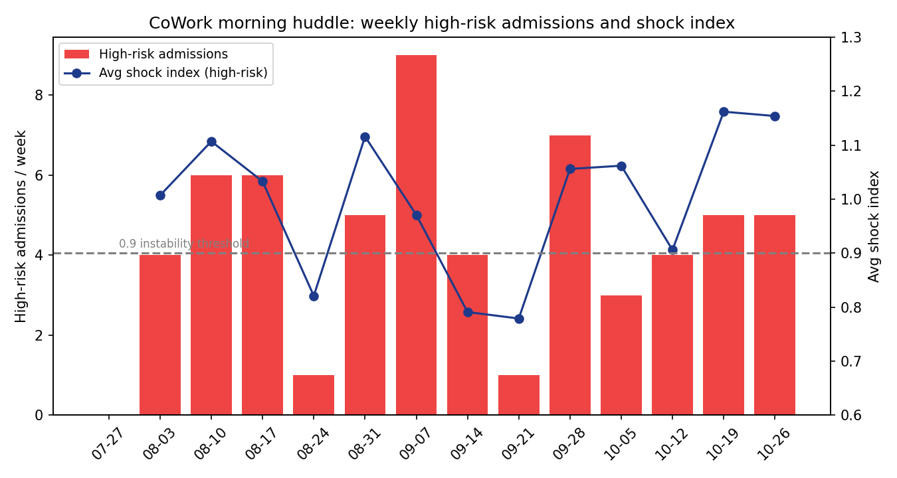
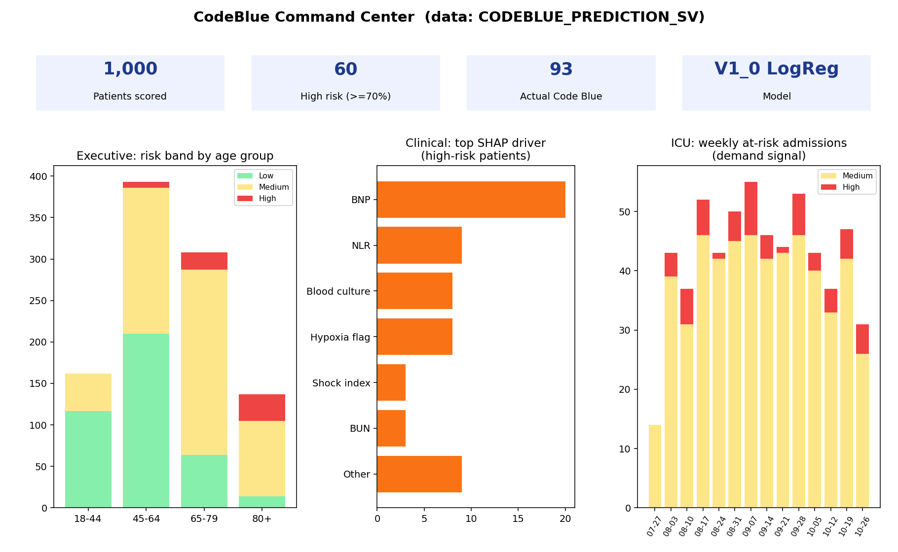
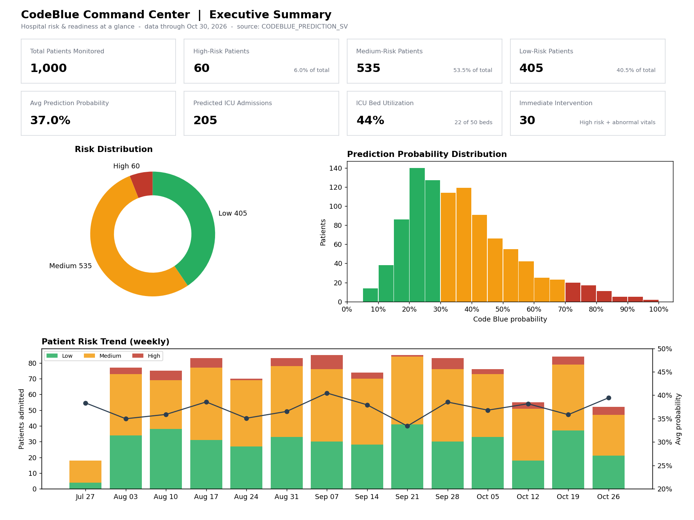
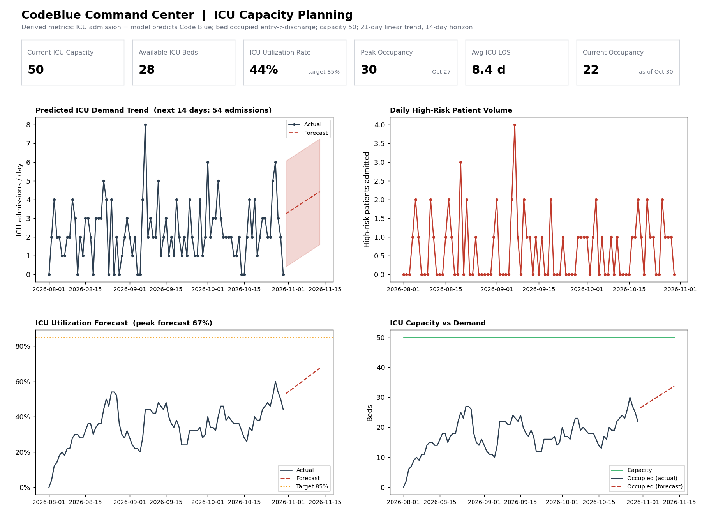

# From Vital Signs to Early Warnings: Building an End-to-End Code Blue Prediction Platform on Snowflake with Cortex Code

*How an AI coding agent took a hospital deterioration use case from raw patient data to a trained model, a natural-language agent and a live command-center dashboard, without leaving Snowflake.*

---

## Introduction

A **Code Blue** is a hospital emergency: a patient has gone into cardiac or respiratory arrest. Studies of in-hospital arrests show that many of these patients had warning signs hours before the event, such as rising respiratory rate, falling blood pressure, dropping oxygen saturation and abnormal labs. The data is usually already in the EHR. What's missing is a system that connects it, scores every patient continuously, and puts the result in front of the care team in time to act.

This post walks through building that system on Snowflake with **Cortex Code (CoCo)**, the AI coding agent built into Snowsight. I described the use case in plain English, and CoCo generated, ran and fixed the code in a Snowflake notebook, then built the AI layer on top.

The solution has two parts:

1. **The ML pipeline.** Six phases take synthetic patient, flowsheet and lab data through feature engineering, a Feature Store, multi-model training with experiment tracking, the Model Registry with SHAP explainability, and batch scoring.
2. **The Cortex AI layer.** A semantic view for Cortex Analyst, a Cortex Agent that answers clinical questions in natural language, a Snowflake CoWork experience for business users, and a Streamlit **CodeBlue Command Center** dashboard.

Everything runs inside one Snowflake account, `DEMO_DB`, on warehouse compute. No data leaves the platform.

> **Note on data:** all patient data in this project is synthetic. It has realistic distributions and correlations, but it doesn't describe real people and results won't carry over directly to a real hospital.

---

## Part 1: The ML Pipeline

The whole pipeline lives in one notebook, `notebooks/CodeBlue_Prediction.ipynb`. It started from a single CoCo prompt beginning `/machine-learning Build a compact, end-to-end ML pipeline for a Code Blue Prediction Model…`, followed by the six phases below.

### Step 1: Create the Training Dataset

CoCo generated **1,000 synthetic hospital encounters** across the previous 90 days, split into three source tables joined on `PRIMARYMRN`:

| Source | Columns |
|---|---|
| Patient | PRIMARYMRN, BIRTHDATE, GENDER, AGE, HEIGHT_CMS, WEIGHT_LBS, ENTRY_DATE, DISCHARGE_DATE |
| Flowsheet | RESPIRATION, SYSTOLIC_BP, DIASTOLIC_BP, TEMPERATURE, PULSE_OXIMETRY, O2_FLOW_RATE, PULSE |
| Vital Lab | ABS_LYMPHOCYTE, ABS_NEUTROPHIL, ALBUMIN, BLOOD_CULTURE, BNP, BUN, CALCIUM |

To make the data clinically believable, a hidden **acuity score** drives correlated vitals and labs. Sicker patients get higher respiratory rate, pulse, BNP and BUN, and lower blood pressure, SpO2 and albumin. The `CODEBLUE` target is drawn from a logistic model of those signals.

- **Class imbalance:** 93 of 1,000 patients (9.3%) had a Code Blue, in line with acute-care populations.
- **Missing values:** about 3% of values were removed on purpose so the pipeline has to handle imputation.
- **Discharge date by severity:** length of stay averages **4.9 days** overall and **12.1 days** for Code Blue patients.

Output: `DEMO_DB.CLINIC.PATIENT_CODEBLUE`.

### Step 2: Feature Engineering and the Feature Store

The feature logic is written in **Snowpark Python** and executes as SQL inside Snowflake, so training and inference use exactly the same transformations.

- **Missing values:** median imputation, with the medians computed once and stored as fixed values.
- **Encoding:** `GENDER` encoded with sklearn's `LabelEncoder` (Female=0, Male=1).
- **Clinical features:** BMI, Mean Arterial Pressure, **Shock Index** (pulse ÷ systolic BP), Neutrophil-to-Lymphocyte Ratio and a Hypoxia flag (SpO2 < 92).
- **Date features:** day of week and month of admission. Length of stay and admission duration are computed for reporting.
- **Scaling:** tree models don't need it. Logistic regression gets a `StandardScaler` inside its pipeline, so the scaler ships with the model.

The features are registered in a **Snowflake Feature Store** (schema `DEMO_DB.FEATURES`) with a `PATIENT` entity and feature view **`FV_CODE_BLUE_PREDICTION` version V1**. The training set is built with `generate_training_set`, which does point-in-time-correct (ASOF) joins.

> **Lesson learned: label leakage.** The first version included length of stay as a feature. Every model scored about 0.98 ROC-AUC, and LOS was the top SHAP driver for nearly every flagged patient. But LOS is only known at *discharge*, and in this data it is longer for Code Blue patients by design. The production model **excludes LOS**. Fig. 3 shows the effect: the metrics drop, and the remaining scores reflect what the model can actually do at admission.


*Fig. 3: Test ROC-AUC with and without the length-of-stay feature.*

### Step 3: Model Training (AutoML-style) and Experiment Tracking

Five model families were trained in the notebook kernel, and every run's parameters and metrics were logged to the Snowflake experiment **`CODE_BLUE_EXPERIMENT`**:

- XGBoost (`scale_pos_weight` for class imbalance)
- LightGBM (`class_weight='balanced'`)
- Random Forest (`balanced_subsample`)
- Logistic Regression (StandardScaler and balanced weights)
- Gradient Boosting Classifier (balanced sample weights)

Training setup:
- **Split:** 80/20 train/test, stratified so both sets keep the same class balance, with random seed 42.
- **Tuning:** number of estimators, learning rate, maximum depth, subsample ratio, minimum samples per split, and C for logistic regression.
- **Validation:** 5-fold cross-validation for the final selection.


*Fig. 1: Mean 5-fold cross-validated ROC-AUC by model family. Error bars show ±1 standard deviation.*


*Fig. 2: Accuracy, precision, recall, F1, ROC-AUC and PR-AUC on the 20% hold-out set.*

| Model (LOS excluded) | CV ROC-AUC | Test ROC-AUC | Recall | Precision | F1 | PR-AUC |
|---|---|---|---|---|---|---|
| **Logistic Regression** | **0.927 ± 0.028** | 0.915 | **0.895** | 0.378 | 0.531 | 0.705 |
| Random Forest | 0.914 ± 0.027 | 0.913 | 0.842 | 0.500 | 0.627 | 0.669 |
| LightGBM | 0.912 ± 0.029 | 0.923 | 0.789 | 0.500 | 0.612 | 0.727 |
| Gradient Boosting | 0.912 ± 0.023 | 0.917 | 0.895 | 0.405 | 0.557 | 0.619 |
| XGBoost | 0.911 ± 0.021 | 0.916 | 0.895 | 0.395 | 0.548 | 0.606 |

**Which metric decides the winner?** Accuracy is misleading at 9% prevalence: a model that predicts "no Code Blue" for everyone scores 91%. The metrics that matter here:

- **Cross-validated ROC-AUC** is the most reliable way to rank models, because it doesn't depend on a threshold and is averaged over five folds rather than one 200-row test set.
- **Recall (sensitivity)** is the clinical priority. A missed Code Blue costs far more than an extra bedside check.

**Logistic Regression** wins on both: the highest CV ROC-AUC (0.927) and 89.5% recall. It caught 17 of the 19 Code Blue patients in the test set. Its precision is lower (0.38), which in practice means more patients flagged for review. For an early-warning tool where clinicians make the final call, that trade-off is acceptable. Logistic regression is also easy for clinicians to interpret.


*Fig. 5: Best-metric view. Logistic Regression sits furthest top-right. It has the highest cross-validated ROC-AUC and ties with XGBoost and Gradient Boosting for the highest recall (0.895). Bubble size shows PR-AUC.*


*Fig. 4: Champion confusion matrix on the 200-patient test set. 17 of 19 Code Blue patients detected, 2 missed, 28 false alarms.*

### Step 4: Model Deployment to the Snowflake Model Registry

The champion was registered as **`DEMO_DB.CLINIC.CODEBLUE_MODEL`, version `V1_0`**, and set as the default (approved) version. The registry version stores:

- **Performance metrics:** accuracy, precision, recall, F1, ROC-AUC and the confusion matrix.
- **Training metadata:** row counts, positive rate, seed, timestamp, and the experiment and run it came from.
- **Feature definitions:** the source feature view, the 25 features, the imputation medians and the gender encoding.
- **Model parameters** and **global feature importance**.
- **Explainability:** enabled, which adds an `EXPLAIN` function that returns SHAP values next to `PREDICT` and `PREDICT_PROBA`.

The top global drivers are clinically sensible: **BNP, Shock Index, Respiratory Rate, Albumin, SpO2, Blood Culture and Age**.

### Step 5: Production Inference

The scoring step loads the **default model version** from the registry, pulls features for all 1,000 encounters from the **same feature view** used in training, and calls:

- `PREDICT_PROBA`, which gives `CODEBLUE_PROBABILITY`. A patient is flagged (`CODEBLUE_PREDICTION`) when it is ≥ 0.5.
- `EXPLAIN`, which gives per-patient SHAP values, stored as JSON listing each patient's **top 5 risk drivers** with their direction.

```json
{"method": "SHAP",
 "top_drivers": [
   {"feature": "NEUTROPHIL_LYMPH_RATIO", "value": 14.2, "contribution": 1.83, "direction": "increases risk"},
   {"feature": "BNP", "value": 1211.0, "contribution": 1.12, "direction": "increases risk"},
   ...]}
```

Results are written to `DEMO_DB.CLINIC.CODEBLUE_SCORING_RESULTS` with `MODEL_VERSION` and `SCORING_TIMESTAMP` for auditability.

### Step 6: Final Dataset Creation

The business-ready table **`DEMO_DB.CLINIC.CODEBLUE_PREDICTION_RESULTS`** is `PATIENT_CODEBLUE` left-joined to the scoring results on `PRIMARYMRN`. It keeps all 1,000 rows and every original demographic, flowsheet and lab field, and adds `CODEBLUE_PREDICTION`, `CODEBLUE_PROBABILITY`, `MODEL_VERSION`, `SCORING_TIMESTAMP` and `EXPLAINABILITY_ATTRIBUTES`.

| Summary | Value |
|---|---|
| Records scored | 1,000 / 1,000 |
| Actual Code Blue events | 93 |
| Flagged by the model (p ≥ 0.5) | 205 |
| Actual events among flagged patients | 80 of 93 (86%) |
| High-risk patients (p ≥ 0.7) | 60 |
| Most common top driver | Respiratory rate |

*These counts cover all 1,000 rows, including the 800 used for training. The hold-out figures in Step 3 are the honest performance estimate.*

---

## Part 2: The Cortex AI Layer

A risk score sitting in a table isn't useful on its own. The second part makes the predictions easy to ask about, explain and act on.

### 1. Cortex Analyst: the semantic view

CoCo created the semantic view **`DEMO_DB.CLINIC.CODEBLUE_PREDICTION_SV`** on top of the final table. It translates clinical language into data:

- **Facts:** vitals, labs, `CODEBLUE_PROBABILITY`, `RISK_SCORE_PCT` (probability × 100), `LENGTH_OF_STAY_DAYS` and a computed `SHOCK_INDEX`.
- **Dimensions:** gender, age group, risk band (High ≥ 0.7, Medium, Low), admission and scoring dates, and top SHAP drivers.
- **Synonyms and clinical comments:** "SpO2" means oxygen saturation, "RR" means respiratory rate, "SBP below 90 indicates hypotension". These are what let Cortex Analyst understand clinicians' wording.

Asking *"Which 5 patients have the highest Code Blue risk score, with age, gender and risk band?"* produced this SQL from Cortex Analyst:

```sql
SELECT primary_mrn, age_years, gender, risk_band, risk_score_pct
FROM __predictions
ORDER BY risk_score_pct DESC NULLS LAST
LIMIT 5  -- Generated by Cortex Analyst
```

| MRN | Age | Gender | Risk % | Top driver |
|---|---|---|---|---|
| MRN1000180 | 84 | F | 98.8 | Neutrophil-lymphocyte ratio |
| MRN1000865 | 76 | F | 95.2 | Neutrophil-lymphocyte ratio |
| MRN1000993 | 84 | F | 94.7 | BNP |
| MRN1000020 | 59 | F | 93.0 | BNP |
| MRN1000446 | 80 | M | 92.8 | BUN |

### 2. Cortex Agent: Code Blue Agent

**`DEMO_DB.CLINIC.CODEBLUE_AGENT`** ("Code Blue Agent") orchestrates the semantic view as a Cortex Analyst tool called `CODEBLUE_PREDICTIONS`. Its instructions tell it to:

- lead with the direct answer and show risk as a percentage;
- identify patients by MRN and include their top risk drivers;
- treat high-risk-patient trends as a stand-in for ICU demand, and say clearly that it's an estimate because there is no bed census data;
- remind users that predictions support clinical judgement and don't replace it.

**Sample conversation (illustrative):**

> **User:** Which patients need immediate attention and why?
>
> **Code Blue Agent:** 60 patients are currently in the **High** risk band (≥ 70% Code Blue probability). The top five are:
>
> | MRN | Risk | Age/Sex | Key drivers |
> |---|---|---|---|
> | MRN1000180 | 98.8% | 84 F | ↑ Neutrophil-lymphocyte ratio, ↑ BNP |
> | MRN1000865 | 95.2% | 76 F | ↑ Neutrophil-lymphocyte ratio |
> | MRN1000993 | 94.7% | 84 F | ↑ BNP |
> | … | | | |
>
> The common pattern is elevated inflammatory and cardiac markers (NLR, BNP) with abnormal respiratory rate. Consider a rapid-response review. *These predictions support, not replace, clinical judgement.*

### 3. Snowflake CoWork: AI for every role

The same agent is available through **Snowflake CoWork**, the conversational workspace for business users. A nurse manager or bed-flow coordinator can get answers without writing SQL or opening a notebook.

**Sample prompt (illustrative):**

> *"Give me a morning huddle summary: how many high-risk patients were admitted in the last 7 days, what's the average shock index for them, and how many ICU beds should we hold for the next 48 hours?"*

CoWork sends the question to the Code Blue Agent. It returns a short summary with a trend chart of high-risk admissions, and an ICU-demand estimate based on high- and medium-risk patient counts, labelled as an estimate. That same answer can feed a daily briefing for leadership.


*Fig. 7: The kind of chart CoWork returns for the huddle prompt, built from the real scored data. Weekly high-risk admissions (bars) are shown against the average shock index of those patients (line). The index stays above the 0.9 instability threshold in most weeks, and the last two weeks are the highest.*

### 4. Streamlit: the CodeBlue Command Center

The last piece is a Streamlit app, **`DEMO_DB.CLINIC.CODEBLUE_COMMAND_CENTER`**, built in Workspaces and powered by the semantic view. It has three tabs:

- **Executive Summary:** "Hospital risk and readiness at a glance". KPI tiles for patients scored, high-risk count, predicted vs actual events and average risk, plus risk-band distribution and trends.
- **Clinical:** "Patients requiring immediate attention". A ranked high-risk worklist with vitals, labs and SHAP drivers, filtered by configurable intervention criteria in the sidebar.
- **ICU:** "ICU demand and capacity". Projected critical-care demand from patient risk profiles, with adjustable ICU assumptions such as bed count and conversion rates.


*Fig. 6: Command Center views on the real scored data. KPI tiles; risk band by age group (high risk is concentrated in patients 65+, with 32 of 60 aged 80+); top SHAP driver among high-risk patients (BNP leads); and weekly medium- and high-risk admissions as the ICU demand signal.*

#### Executive Summary tab


*Fig. 8: Executive Summary, recreated from the scored data using the app's default settings. 1,000 patients monitored; 60 high risk (6.0%), 535 medium (53.5%) and 405 low (40.5%). Average Code Blue probability is 37.0%. 205 predicted ICU admissions, 44% ICU bed utilization (22 of 50 beds), and 30 patients needing immediate intervention (high risk plus SBP < 90, HR > 120, RR > 24 or SpO2 < 90). Below the tiles: risk-band donut, probability histogram, and weekly admissions by risk band with the average probability trend line.*

#### ICU Capacity Planning tab


*Fig. 9: ICU Capacity Planning, using the app's logic. A patient counts as an ICU admission when the model predicts Code Blue, and occupies a bed from admission to discharge. Capacity is 50 beds, with a 21-day linear trend projected 14 days ahead. 28 beds are available now; peak occupancy was 30 beds on Oct 27; average ICU length of stay is 8.4 days. About 54 ICU admissions are projected over the next 14 days, with utilization peaking at about 67%, below the 85% target. These ICU figures are estimates: there is no real bed census in the data.*

Because the app queries the semantic view rather than raw tables, its metric definitions (risk band, risk score, shock index) match the agent and Cortex Analyst exactly.

---

## Business Goals and Benefits

### Clinical goals

- **Find deteriorating patients early.** Every patient gets a continuous risk score from routine vitals and labs, catching 17 of 19 Code Blue patients in hold-out testing.
- **Reduce Code Blue events and related deaths.** Earlier warnings make rapid-response review possible while there is still time to act.
- **Improve safety and quality of care.** Each score comes with SHAP drivers (BNP, shock index, respiratory rate), so clinicians can see why a patient was flagged and decide what to do.

### Operational goals

- **Better ICU bed planning.** High- and medium-risk counts act as an early signal of critical-care demand, so beds and staff can be prepared before emergencies happen.
- **Forecast ICU demand from risk profiles.** Trends by admission date, age group and risk band support capacity planning and transfer decisions.
- **Self-service answers.** The Code Blue Agent and CoWork let operations leaders ask questions in plain English without waiting on analysts.

### Platform benefits

- **One governed platform.** Data, features, models, explanations, agent and dashboard all sit in Snowflake under the same access controls, which matters for patient data.
- **Reproducible and auditable.** Feature Store lineage, experiment tracking and registry metadata link every prediction to its model version, training run and feature definitions.
- **Faster delivery with CoCo.** The pipeline was built from natural-language prompts. CoCo wrote the code, ran it, read the errors and fixed them, so the team spent its time on clinical design and review.

---

## Conclusion

### Cortex Code: from prompt to production in one conversation

The biggest takeaway from this project is how much **Cortex Code (CoCo)** compressed the work. Wiring together data generation, a Feature Store, five model families, a registry, explainability, batch scoring, a semantic view, an agent and a dashboard normally means hand-coding across several tools and skill sets. Here it was all driven from a chat panel inside Snowsight.

**How CoCo helped with the ML pipeline**
- **One prompt, six phases.** A single `/machine-learning` prompt produced a structured, documented notebook covering all six phases. CoCo created the database, schemas and warehouse, wrote every cell and ran them end to end on warehouse compute.
- **Snowflake-native APIs by default.** CoCo loaded Snowflake's built-in ML and notebook skills before writing code, so it used `FeatureStore`, `generate_training_set`, `ExperimentTracking` and `Registry.log_model(enable_explainability=True)` directly, without generic workarounds.
- **It ran the code, read the errors and fixed them.** Two real failures happened during the run:
  - The Feature Store switched schema context, so an unqualified table name broke.
  - A quote character in a feature description broke the generated SQL comment.

  CoCo diagnosed both from the error output, fixed the cells and re-ran them without the user stepping in.
- **It flagged a result that was too good.** After the first run, CoCo pointed out that length of stay dominated the SHAP drivers and warned that it leaks the outcome. The pipeline was then updated to exclude LOS, which produced the leakage-free model now in production. An agent that questions its own good-looking results is worth more than one that only reports them.
- **Experiment tracking and reporting.** Every run's parameters and metrics went to `CODE_BLUE_EXPERIMENT`. CoCo later read those runs back with SQL to build the leaderboard and charts in this post, so every number comes from logged data.

**How CoCo helped with Cortex AI**
- **Semantic view authoring.** It turned the scored table into a semantic view with clinical synonyms ("SpO2", "RR", "shock index") and comments, so Cortex Analyst understands how clinicians phrase questions.
- **Agent configuration.** It defined the Code Blue Agent's tools, orchestration rules, response style and sample questions, including the guardrail that predictions support clinical judgement rather than replace it.
- **Dashboard build.** Using the Streamlit-in-Workspaces skill, it built the CodeBlue Command Center against the semantic view. The dashboard, Cortex Analyst, the agent and CoWork therefore share one set of metric definitions.

**Reuse, repeatability and governance**
- **Reusable skill.** The refined prompt was saved as a personal CoCo skill (`/codeblue-prediction-pipeline`). The whole pipeline can now be rebuilt with one command, on new data or in a different database or schema.
- **Human in the loop.** Snowsight's consent prompts let the user approve write operations, and plan mode and Restrict Chat are available for tighter control. CoCo runs with the user's own role, so everything stays inside Snowflake's governance and audit boundary.
- **The right division of labour.** CoCo handled code, debugging, wiring and documentation. People made the decisions that matter: the clinical framing, the choice of metric, the leakage review and deployment approval.

### Key ML and clinical takeaways

- **Snowflake covers the whole ML lifecycle.** Snowpark feature engineering, the Feature Store, experiment tracking, the Model Registry with built-in SHAP, and warehouse batch inference work together without extra infrastructure.
- **Check models for leakage.** The 0.98 ROC-AUC model looked impressive, but it was learning from length of stay. Removing that feature brought it down to an honest ~0.92. Ask whether each feature is actually available at the moment you predict.
- **Choose the metric that matches the clinical risk.** At 9% prevalence, accuracy says little. Cross-validated ROC-AUC and recall are what should drive model selection.
- **Why Logistic Regression was chosen, and how close the others were.** It had the highest mean 5-fold CV ROC-AUC (**0.927 ± 0.028**) and tied for the highest recall (**0.895**, 17 of 19 Code Blue patients caught). CV ROC-AUC was the primary metric because it doesn't depend on a threshold and is averaged over five folds, so it ranks models more reliably than one 200-row test set. Recall was the deciding secondary metric because a missed Code Blue is far costlier than a false alarm. It is also the most interpretable model for clinicians. The other models were close:
  - **Random Forest:** CV ROC-AUC 0.914, recall 0.842, and better precision (0.50) and F1 (0.63).
  - **LightGBM:** CV ROC-AUC 0.912 and the best PR-AUC (0.727) and test ROC-AUC (0.923), but lower recall (0.789).
  - **Gradient Boosting** (0.912) and **XGBoost** (0.911): same recall as the champion (0.895), but slightly lower precision.

  All five sit within about 0.016 CV ROC-AUC of each other, less than one standard deviation. So the choice is a clinical trade-off between recall, precision and interpretability, not a clear statistical winner. If false alarms become a problem, Random Forest or LightGBM are strong alternatives.
- **Synthetic data: results will vary.** This use case uses **synthetic sample data** with built-in correlations, a 9.3% Code Blue rate and 1,000 records. Every metric, chart, risk count and ICU estimate in this post reflects that sample. Real patient data will give different results, because of factors such as time-series vitals, missing-data patterns, documentation practices, case mix and true event rates. The champion model, the decision threshold and the best metric may all change. Retrain, revalidate and recalibrate on real, de-identified data before drawing any clinical conclusions.
- **Explanations build trust.** SHAP drivers stored with each prediction let clinicians check the model's reasoning.
- **The semantic view is the shared layer.** One definition of "high risk" serves Cortex Analyst, the Cortex Agent, CoWork and the Streamlit dashboard.
- **Next steps, also driven through CoCo:**
  - re-run the `/codeblue-prediction-pipeline` skill on real, de-identified EHR data with time-series vitals;
  - tune the decision threshold with clinicians;
  - have CoCo schedule daily scoring as a Snowflake Task or a `cortex automation`;
  - add a model monitor for drift;
  - before any clinical use, run a prospective evaluation with appropriate clinical governance.

*Predictive models support clinical decision-making. They don't replace the judgement of trained healthcare professionals.*

---

**Tags:** #Snowflake #MachineLearning #Healthcare #CortexAI #CortexCode #MLOps #Streamlit #Predi